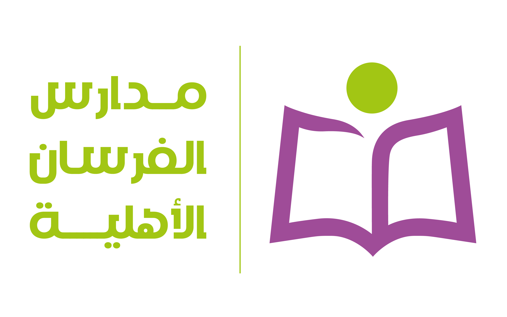
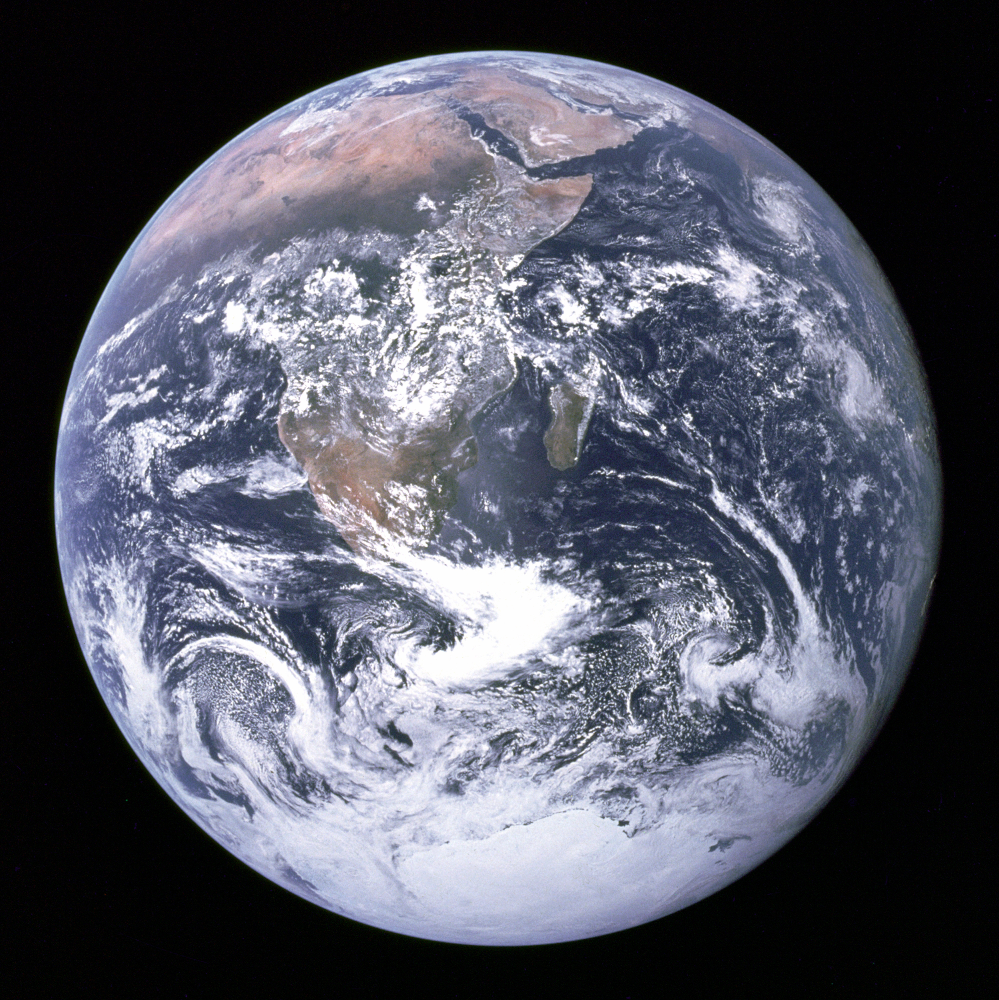
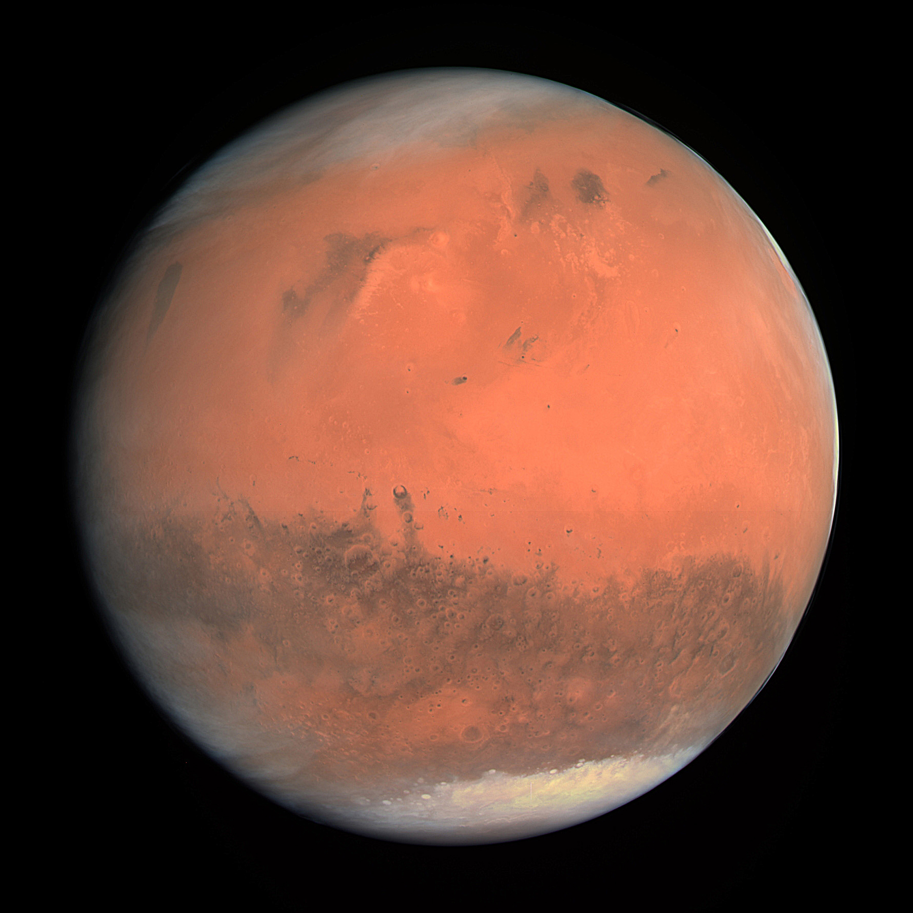

<p align="center">
  
</p>

<h1 align="center">بوابة أسبوع الفضاء العالمي | ثانوية الفرسان الأهلية</h1>
<p align="center"><strong>World Space Week Interactive Web Portal (2026)</strong></p>

<p align="center">
  <a href="#arabic">العربية ↓</a> •
  <a href="https://gmc2000.github.io/-1/">Live Demo ↗</a>
</p>

An interactive scientific web platform built for **World Space Week 2026** at **Al-Forsan High School in Makkah**. Designed with a modern **Dark Glassmorphism UI**, the portal combines real-time space weather data, interactive physics simulations, deep space discovery modules, and an AI space lab — offering students and visitors an immersive educational journey.

Built with **HTML5, CSS3, and Vanilla JavaScript** — zero heavy frameworks, fully responsive, and hosted directly on **GitHub Pages**.

---

## Live Preview

|  |  |
| --- | --- |
|  |  |

---

## Key Features

- **AI Space Lab** — explore four foundational pillars of AI in deep space:
  - Autonomous navigation (*AutoNav*) on Mars rovers.
  - Deep learning algorithms detecting exoplanets via transit light curves.
  - Orbital debris shield & Non-Terrestrial Networks (*NTN*).
  - Intelligent astronaut assistants (*CIMON*) and an interactive mission-decision simulator.
- **Live Space Weather Radar** — visual sweep radar and telemetry monitoring NOAA scales (**G-Scale, S-Scale, R-Scale**) alongside real-time solar wind speed, proton density, and geomagnetic field indices.
- **3D Solar System & Comparison Matrix** — physical and astronomical data for all 8 planets, the Sun, and Moon phases, paired with a dynamic comparison tool for gravity, diameter, and distance.
- **Saudi Space Sector (CST & SSA)** — highlights the Kingdom's achievements in space exploration:
  - Saudi Space Agency (**SSA**) & Communications, Space & Technology Commission (**CST**).
  - Historic Ax-2 space mission (*Rayyanah Barnawi & Ali AlQarni*) and HRH Prince Sultan bin Salman.
- **NASA Discovery Hub** — direct integrations with:
  - 3D interactive NASA Eyes (*Solar System, Earth, Asteroids*).
  - Astronomy Picture of the Day (*NASA APOD*) with live API support.
  - James Webb Space Telescope (*JWST*) vs. Hubble comparisons.
  - Mars weather and Perseverance rover imagery.
- **PhET Interactive Physics Lab** — embedded simulation sandboxes developed by the University of Colorado Boulder:
  - Gravity and planetary orbits.
  - Universal gravitational force calculator.
  - Multi-body planetary systems & projectile motion.
- **Planetary Weight Calculator** — interactive tool to calculate weight across multiple celestial bodies based on surface gravity.
- **Space Quiz & Certified Digital Credential** — a knowledge challenge that generates a printable, customized certificate of completion on the fly.
- **Project Report Modal** — embedded, full-screen documentation report ready for viewing and PDF export.

---

## Project Structure

```text
├── index.html          # Core single-page interactive application
├── report.html         # Comprehensive documentation & event report
├── README.md           # Project documentation
└── images/             # Visual assets and media directory
    ├── school_logo.png # Al-Forsan High School emblem
    ├── planets/        # High-res celestial bodies
    ├── astronauts/     # Arab and international pioneers
    ├── nasa/           # NASA & JWST imagery
    └── saudi_space/    # CST and SSA official branding

```

---

## Live Access & Deployment

The portal is continuously deployed and accessible globally via GitHub Pages:

**[🌐 Visit the Live Portal](https://gmc2000.github.io/-1/)**

To run locally:

1. Clone the repository:
```bash
git clone [https://github.com/GMC2000/-1.git](https://github.com/GMC2000/-1.git)

```


2. Open `index.html` in any modern web browser.

---

## Project Team & Credits

* **School:** Al-Forsan Private High School, Makkah, Saudi Arabia
* **General Supervisor & School Principal:** Mr. Mohsen Ruddah Allah Al-Saeedi
* **Activity Leader & Supervising Teacher:** Mr. Ayman Al-Banna
* **Student Development Team:**
* **Mohammed Alhazmi**
* **Ahmed Bait Al-Mal**
* **Abdulhamid Talaat**


---

## License

This educational platform is published under the [MIT License](https://www.google.com/search?q=LICENSE) for World Space Week 2026.

---
<p align="center">
  
</p>

<h1 align="center">بوابة أسبوع الفضاء العالمي | ثانوية الفرسان الأهلية</h1>
<p align="center"><strong>لبوابة الإلكترونية التفاعلية لأسبوع الفضاء العالمي (2026) </strong></p>

<p align="center">
  <a href="#arabic">العربية ↓</a> •
  <a href="https://gmc2000.github.io/-1/">Live Demo ↗</a>
</p>

# بوابة أسبوع الفضاء العالمي — ثانوية الفرسان الأهلية

منصة ويب علمية تفاعلية تم تطويرها بمناسبة **أسبوع الفضاء العالمي 2026** بـ **ثانوية الفرسان الأهلية بمكة المكرمة**. صُممت المنصة بنمط **الواجهات الزجاجية المظلمة (Dark Glassmorphism)** الحديث، وتجمع بين الرصد الفوري للطقس الفضائي، وتطبيقات الذكاء الاصطناعي في الفضاء السحيق، ومحاكيات الفيزياء المدارية، وجناح الفضاء السعودي ووكالة ناسا.

مبنية بالكامل باستخدام **HTML5 وCSS3 وVanilla JavaScript** — دون أطر عمل ثقيلة، ومتوافقة مع جميع مقاسات الشاشات والهواتف، وتعمل مباشرة عبر **GitHub Pages**.

---

## أبرز المزايا والركائز العلمية

* **مختبر الذكاء الاصطناعي في الفضاء (AI Space Lab)** — استعراض تطبيقات الذكاء الاصطناعي في الاستكشاف الكوني:
* القيادة الذاتية للمركبات المريخية (*AutoNav*).
* صيد الكواكب الخارجية وتحليل منحنيات الضوء بالتعلم العميق.
* درع المدارات الذكي وتفادي الحطام الفضائي لحماية الأقمار والشبكات غير الأرضية (*NTN*).
* المساعدات الذكية للرواد (*CIMON*) ومحاكي قرارات الملاحة الذاتية التفاعلي.


* **رادار الطقس الفضائي الحي** — مسح راداري بصري ومتابعة مستمرة لمقاييس NOAA (**G-Scale وS-Scale وR-Scale**)، مع قراءات فورية لسرعة الرياح الشمسية وكثافة البروتونات والمجال المغناطيسي.
* **النظام الشمسي وأداة المقارنة التفاعلية** — بطاقات ثلاثية الأبعاد للكواكب الثمانية، والشمس وأطوار القمر، مع أداة حية لمقارنة الجاذبية والقطر والمسافة بين أي كوكبين.
* **المملكة نحو الفضاء (الفضاء السعودي)** — توثيق إنجازات قطاع الفضاء الوطني:
* هيئة الاتصالات والفضاء والتقنية (**CST**) ووكالة الفضاء السعودية (**SSA**).
* توثيق مهمة Ax-2 التاريخية (*ريانة برناوي وعلي القرني*) ورحلة صاحب السمو الملكي الأمير سلطان بن سلمان.


* **جناح وكالة ناسا التفاعلي** — تكامل مباشر مع:
* محاكي ناسا ثلاثي الأبعاد (*NASA Eyes on the Solar System*).
* صورة اليوم الفلكية (*NASA APOD*) مع جلب مباشر من NASA API.
* مقارنة تلسكوب هابل وجيمس ويب (*JWST*).
* طقس المريخ المباشر ومعرض صور مسبار Perseverance.


* **مختبر محاكيات PhET الفيزيائية** — تجارب معملية تفاعلية معتمدة من جامعة كولورادو:
* الجاذبية وحركة المدارات الفضائية.
* قياس قوى التجاذب بالنيوتن وقانون التربيع العكسي.
* ميكانيكا المقذوفات الصاروخية والأنظمة متعددة الأجرام.


* **حاسبة الوزن على الأجرام السماوية** — أداة لحساب وزن الزائر على الكواكب والقمر والشمس وفق تسارع الجاذبية لكل جرم.
* **تحدي الفضاء والشهادة الرقمية المعتمدة** — اختبار معرفي تفاعلي يتيح إصدار شهادة شكر وتقدير رسمية باسم الطالب قابلة للطباعة المباشرة وحفظها PDF.
* **نافذة التقرير الموثق** — عرض التقرير الشامل والموثق للفعالية بملء الشاشة مع دعم الطباعة.

---

## هيكلة المشروع

```text
├── index.html          # الملف الرئيسي والواجهة التفاعلية الشاملة
├── report.html         # التقرير الختامي والتوثيقي الكامل للفعالية
├── README.md           # دليل التوثيق والتعريف بالمشروع
└── images/             # مجلد الوسائط والصور المعتمدة
    ├── school_logo.png # شعار مدارس الفرسان الأهلية
    ├── planets/        # صور كواكب المجموعة الشمسية
    ├── astronauts/     # صور رواد الفضاء العرب والعالميين
    ├── nasa/           # صور ناسا وتلسكوب جيمس ويب
    └── saudi_space/    # شعارات وصور قطاع الفضاء السعودي

```

---

## التشغيل والرابط المباشر

المنصة مستضافة ومنشورة بالكامل عبر خوادم GitHub Pages ويمكن استعراضها مباشرة من أي متصفح:

**[🌐 زيارة منصة أسبوع الفضاء العالمي](https://gmc2000.github.io/-1/)**

للتشغيل والتجربة محلياً:

1. استنسخ المستودع:
```bash
git clone [https://github.com/GMC2000/-1.git](https://github.com/GMC2000/-1.git)

```


2. افتح ملف `index.html` في أي متصفح ويب.

---

## بطاقة المشروع والاعتماد التعليمي

* **المدرسة:** ثانوية الفرسان الأهلية بمكة المكرمة
* **المشرف العام ومدير المدرسة:** أ. محسن ردة الله الصاعدي
* **المعلم المشرف ورائد النشاط:** أ. أيمن البنا
* **فريق العمل والتنفيذ الطلابي:**
* الطالب: **محمد الحازمي**
* الطالب: **أحمد بيت المال**
* الطالب: **عبدالحميد طلعت**


---

## الرخصة

جميع الحقوق محفوظة بمناسبة أسبوع الفضاء العالمي © 2026 — مرخص بموجب رخصة [MIT](https://www.google.com/search?q=LICENSE).
